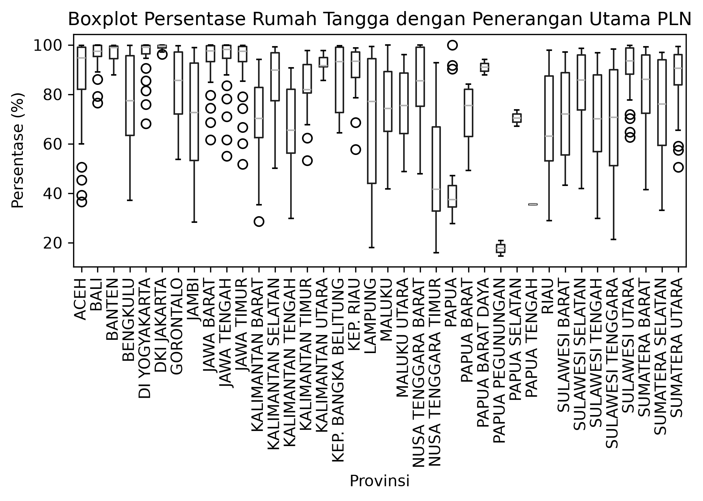

# Tahap 2 – Analisis Statistik Deskriptif dan Deteksi Calon Anomali

## 1. Tujuan

Tahap 2 dilakukan untuk menganalisis karakteristik data menggunakan statistik deskriptif dan mendeteksi calon anomali pada dataset BPS. Analisis dilakukan terhadap variabel `var87` dan tabel `sdg7_bahan_bakar`.

Analisis ini bertujuan untuk mengetahui persebaran nilai data, melihat pola perubahan dari waktu ke waktu, serta mengidentifikasi nilai yang memiliki karakteristik berbeda dari sebagian besar data. Pada tahap ini, anomali hanya ditandai sebagai calon anomali dan belum dilakukan perbaikan terhadap data.

## 2. Dataset yang Digunakan

Dataset yang digunakan berasal dari data BPS, yaitu:

1. **var87 (SDG 7.1.1)**: Persentase rumah tangga menurut provinsi dan sumber penerangan utama dari listrik PLN.
2. **sdg7_bahan_bakar**: Data persentase rumah tangga menurut jenis bahan bakar untuk memasak.

Analisis dilakukan berdasarkan wilayah, periode tahun, dan kategori bahan bakar sesuai karakteristik masing-masing dataset.

## 3. Statistik Deskriptif var87

Dataset `var87` memiliki 1.036 baris data yang terdiri dari 38 provinsi dan data nasional. Periode data yang tersedia adalah tahun 1993–2025, dengan tahun 2005 tidak tersedia.

Analisis statistik deskriptif dilakukan terhadap data provinsi, dengan total 1.004 data.

### Ringkasan Statistik

| Statistik | Nilai |
|---|---:|
| Jumlah data | 1.004 |
| Rata-rata | 79,27 |
| Standar deviasi | 20,84 |
| Minimum | 14,53 |
| Q1 | 65,89 |
| Median | 86,48 |
| Q3 | 97,14 |
| Maksimum | 100,00 |

Hasil statistik menunjukkan bahwa persentase rumah tangga yang menggunakan listrik PLN sebagai sumber penerangan utama memiliki rata-rata sekitar 79,27%. Nilai minimum sebesar 14,53% dan maksimum sebesar 100% menunjukkan adanya perbedaan kondisi antarprovinsi dan periode pengamatan.

Ringkasan statistik per provinsi tersedia pada file berikut:

- [Profil statistik var87 per provinsi](profil_var87_per_provinsi.csv)

## 4. Statistik Deskriptif Bahan Bakar

Dataset `sdg7_bahan_bakar` memiliki data persentase rumah tangga menurut jenis bahan bakar untuk memasak. Kategori `Jumlah` tidak disertakan dalam analisis distribusi karena merupakan nilai agregat dari seluruh kategori bahan bakar.

Profil statistik dihitung berdasarkan masing-masing jenis bahan bakar. Jumlah data pada setiap kategori dapat berbeda karena ketersediaan data.

### Ringkasan Statistik per Jenis Bahan Bakar

| Jenis Bahan Bakar | Mean | Median | Minimum | Maksimum |
|---|---:|---:|---:|---:|
| Arang/Briket | 0,62 | 0,11 | 0,00 | 9,08 |
| Gas/Elpiji | 44,25 | 49,40 | 0,26 | 96,28 |
| Kayu | 34,50 | 32,23 | 0,02 | 85,25 |
| Lainnya | 1,34 | 0,79 | 0,10 | 10,54 |
| Listrik | 0,96 | 0,76 | 0,00 | 5,84 |
| Minyak Tanah | 18,38 | 13,84 | 0,00 | 70,82 |

Hasil statistik menunjukkan bahwa Gas/Elpiji memiliki rata-rata persentase tertinggi, yaitu 44,25%, diikuti oleh Kayu sebesar 34,50% dan Minyak Tanah sebesar 18,38%.

Perbedaan nilai rata-rata dan median pada beberapa jenis bahan bakar menunjukkan adanya distribusi data yang tidak selalu simetris. Hal tersebut juga menjadi salah satu alasan dilakukannya pemeriksaan terhadap nilai-nilai yang berpotensi menjadi calon anomali.

Ringkasan statistik bahan bakar tersedia pada:

- [Profil bahan bakar per jenis](profil_bahan_bakar_per_jenis.csv)
- [Profil bahan bakar per wilayah](profil_bahan_bakar_per_wilayah.csv)

## 5. Visualisasi Data

Visualisasi dibuat untuk melihat distribusi nilai dan pola perubahan data berdasarkan waktu.

### 5.1 Boxplot var87

Boxplot digunakan untuk melihat persebaran data persentase rumah tangga pengguna listrik PLN pada setiap provinsi. Grafik memperlihatkan adanya perbedaan distribusi nilai antarprovinsi serta beberapa nilai yang berpotensi menjadi pencilan.

### 5.2 Boxplot Bahan Bakar

Boxplot digunakan untuk melihat distribusi persentase penggunaan berbagai jenis bahan bakar. Perbedaan persebaran antarjenis bahan bakar menunjukkan bahwa setiap kategori memiliki karakteristik data yang berbeda. Beberapa kategori memiliki rentang nilai yang lebih luas dibandingkan kategori lainnya.

### 5.3 Deret Waktu var87

Grafik deret waktu menunjukkan perkembangan persentase rumah tangga yang menggunakan listrik PLN sebagai sumber penerangan utama dari tahun ke tahun berdasarkan data nasional. Grafik memperlihatkan kecenderungan peningkatan penggunaan listrik PLN selama periode pengamatan.

### 5.4 Deret Waktu Bahan Bakar

Grafik deret waktu memperlihatkan perubahan persentase penggunaan enam jenis bahan bakar berdasarkan data nasional pada periode yang tersedia. Grafik dapat digunakan untuk melihat perubahan pola penggunaan bahan bakar, seperti peningkatan penggunaan Gas/Elpiji serta perubahan penggunaan Kayu dan Minyak Tanah.

Seluruh grafik disimpan pada folder `reports/gambar/`.

## 6. Deteksi Calon Anomali

Deteksi calon anomali dilakukan menggunakan metode Interquartile Range (IQR) dan Z-Score.

Metode IQR digunakan untuk mengidentifikasi nilai yang berada di luar batas bawah dan batas atas berdasarkan kuartil. Sementara itu, Z-Score digunakan untuk melihat nilai yang memiliki jarak relatif besar dari rata-rata.

Nilai yang terdeteksi oleh salah satu atau kedua metode dicatat sebagai calon anomali. Hasil deteksi tidak langsung dianggap sebagai kesalahan data.

### 6.1 Calon Anomali var87

Pada dataset `var87`, ditemukan sebanyak **42 calon anomali** dari data provinsi yang dianalisis.

Distribusi hasil deteksi berdasarkan metode:

| Metode | Jumlah |
|---|---:|
| IQR | 35 |
| IQR dan Z-Score | 7 |
| **Total** | **42** |

Calon anomali ditemukan pada 13 wilayah. Wilayah dengan jumlah calon anomali terbanyak adalah:

| Wilayah | Jumlah Calon Anomali |
|---|---:|
| DI Yogyakarta | 5 |
| Jawa Tengah | 5 |
| Jawa Timur | 5 |
| Sulawesi Utara | 4 |
| Aceh | 4 |
| Jawa Barat | 4 |
| Papua | 3 |
| Bali | 3 |
| Sumatera Utara | 3 |
| Kalimantan Timur | 2 |
| Kep. Riau | 2 |
| Kalimantan Barat | 1 |
| DKI Jakarta | 1 |

Beberapa calon anomali ditemukan pada periode awal pengamatan. Nilai tersebut perlu dilihat berdasarkan perkembangan penggunaan listrik PLN dari waktu ke waktu, karena nilai yang relatif rendah pada periode awal dapat mencerminkan kondisi historis, bukan kesalahan pencatatan.

Hasil deteksi calon anomali var87 tersedia pada:

- [Daftar calon anomali var87](calon_anomali_var87.csv)

### 6.2 Calon Anomali Bahan Bakar

Pada dataset bahan bakar, ditemukan sebanyak **104 calon anomali dari 3.153 nilai yang diperiksa**.

Distribusi hasil deteksi berdasarkan metode:

| Metode | Jumlah |
|---|---:|
| IQR | 90 |
| IQR dan Z-Score | 14 |
| **Total** | **104** |

Distribusi calon anomali berdasarkan jenis bahan bakar:

| Jenis Bahan Bakar | Jumlah Calon Anomali |
|---|---:|
| Arang/Briket | 34 |
| Minyak Tanah | 26 |
| Listrik | 24 |
| Lainnya | 11 |
| Gas/Elpiji | 7 |
| Kayu | 2 |
| **Total** | **104** |

Calon anomali paling banyak ditemukan pada kategori Arang/Briket, diikuti Minyak Tanah dan Listrik. Hal ini menunjukkan bahwa nilai ekstrem tidak hanya muncul pada kategori dengan persentase penggunaan tinggi, tetapi juga pada kategori bahan bakar dengan persentase penggunaan relatif rendah.

Hasil deteksi calon anomali bahan bakar tersedia pada:

- [Daftar calon anomali bahan bakar](calon_anomali_bahan_bakar.csv)

## 7. Pemeriksaan Konteks Calon Anomali

Pemeriksaan konteks dilakukan dengan membandingkan nilai calon anomali dengan nilai pada tahun-tahun di sekitarnya. Pemeriksaan ini bertujuan untuk melihat apakah nilai yang terdeteksi merupakan perubahan yang bersifat lokal, bagian dari tren, atau memiliki pola tertentu dalam periode pengamatan.

### Contoh Pemeriksaan Konteks

#### 7.1 Listrik pada Tahun 2001

Calon anomali kategori Listrik ditemukan pada tahun 2001 di beberapa wilayah, antara lain:

| Wilayah | Tahun | Nilai |
|---|---:|---:|
| Jambi | 2001 | 2,99 |
| Jawa Barat | 2001 | 3,68 |
| Jawa Timur | 2001 | 2,86 |
| Kalimantan Timur | 2001 | 4,52 |
| Lampung | 2001 | 2,48 |
| Nusa Tenggara Barat | 2001 | 2,47 |
| Nusa Tenggara Timur | 2001 | 1,62 |
| Papua | 2001 | 1,56 |
| Sulawesi Selatan | 2001 | 3,79 |

Kemunculan calon anomali pada tahun yang sama di beberapa wilayah menunjukkan bahwa nilai tersebut perlu ditinjau berdasarkan konteks periode pengamatan. Nilai-nilai tersebut tidak langsung dianggap sebagai kesalahan data.

#### 7.2 Lainnya pada Kalimantan Barat

Pada kategori Lainnya di Kalimantan Barat, terdapat perubahan nilai pada periode 2007–2011:

| Tahun | Nilai |
|---|---:|
| 2007 | 0,46 |
| 2008 | 0,86 |
| 2009 | 1,41 |
| 2010 | 0,38 |
| 2011 | 0,28 |

Nilai tahun 2009 terdeteksi sebagai calon anomali. Jika dilihat berdasarkan tahun sebelum dan sesudahnya, terdapat peningkatan nilai yang kemudian diikuti penurunan. Oleh karena itu, nilai tersebut dicatat sebagai calon anomali temporal yang perlu ditinjau lebih lanjut.

Hasil pemeriksaan konteks tersedia pada:

- [Konteks calon anomali bahan bakar](konteks_anomali_bahan_bakar.csv)

## 8. Catatan dan Keterbatasan Analisis

Calon anomali yang ditemukan tidak langsung dianggap sebagai kesalahan data. Pada `var87`, beberapa nilai rendah berasal dari periode awal pengamatan yang dapat mencerminkan perkembangan penggunaan listrik PLN dari waktu ke waktu.

Pada dataset bahan bakar, beberapa nilai yang ditandai juga perlu dilihat berdasarkan perubahan penggunaan bahan bakar pada tahun-tahun di sekitarnya. Perbedaan distribusi antarjenis bahan bakar dapat menyebabkan nilai tertentu terdeteksi sebagai calon anomali secara statistik.

Pemeriksaan konteks dilakukan sebagai langkah pendukung interpretasi, tetapi belum dapat memastikan penyebab perubahan nilai. Oleh karena itu, seluruh nilai yang terdeteksi tetap dipertahankan dan hanya dicatat sebagai calon anomali untuk pemeriksaan lebih lanjut.

## 9. Kesimpulan

Berdasarkan analisis yang telah dilakukan, statistik deskriptif berhasil digunakan untuk menggambarkan karakteristik dataset `var87` dan `sdg7_bahan_bakar`.

Visualisasi boxplot dan deret waktu digunakan untuk membantu melihat distribusi serta pola perubahan data. Deteksi menggunakan metode IQR dan Z-Score menghasilkan 42 calon anomali pada `var87` dan 104 calon anomali pada data bahan bakar.

Pemeriksaan konteks dilakukan terhadap calon anomali bahan bakar dengan membandingkan nilai pada tahun sebelum dan sesudahnya. Hasil pemeriksaan menunjukkan bahwa beberapa nilai yang terdeteksi memiliki pola perubahan yang perlu ditinjau lebih lanjut.

Seluruh hasil analisis, ringkasan profil statistik, daftar calon anomali, pemeriksaan konteks, dan grafik telah disimpan di dalam folder `reports/`.

Pada tahap ini tidak dilakukan penghapusan atau perubahan nilai karena tujuan analisis adalah menemukan dan mencatat calon anomali untuk ditinjau lebih lanjut.
