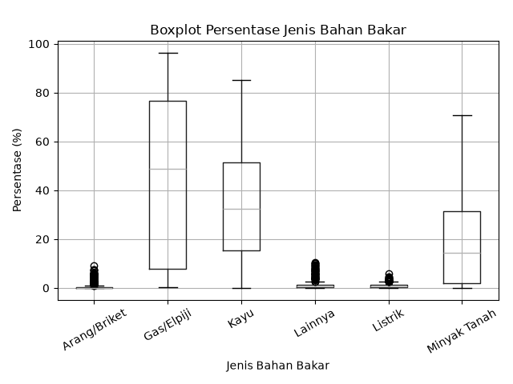
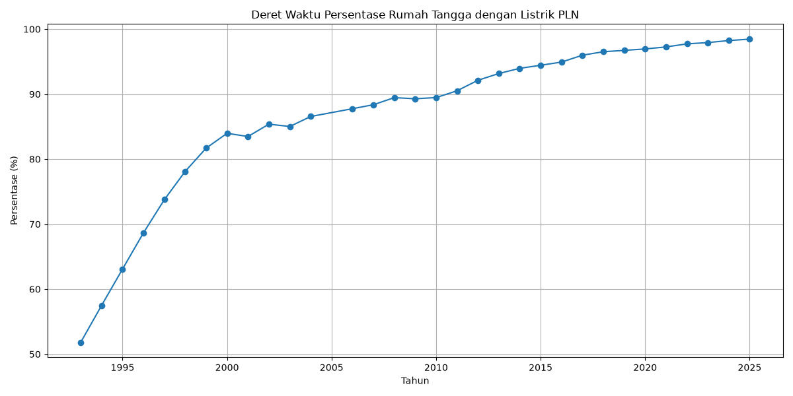
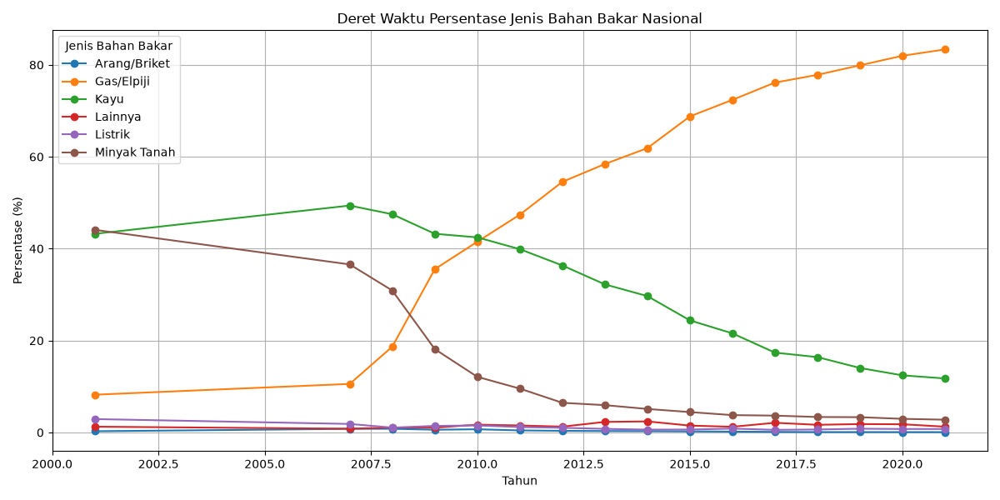

# Tahap 2 – Analisis Statistik Deskriptif dan Deteksi Calon Anomali

## 1. Tujuan

Tahap 2 dilakukan untuk menganalisis karakteristik data menggunakan statistik deskriptif dan mendeteksi calon anomali pada dataset BPS. Analisis dilakukan terhadap variabel `var87` dan tabel `sdg7_bahan_bakar`.

Analisis ini bertujuan untuk mengetahui persebaran nilai data, melihat pola perubahan dari waktu ke waktu, serta mengidentifikasi nilai yang memiliki karakteristik berbeda dari sebagian besar data. Pada tahap ini, anomali hanya ditandai sebagai calon anomali dan belum dilakukan perbaikan terhadap data.

## 2. Dataset yang Digunakan

Dataset yang digunakan berasal dari data BPS, yaitu:

1. **var87 (SDG 7.1.1)**: Persentase rumah tangga menurut provinsi dan sumber penerangan utama dari listrik PLN.
2. **sdg7_bahan_bakar**: Data persentase rumah tangga menurut jenis bahan bakar untuk memasak.

Analisis dilakukan berdasarkan wilayah, periode tahun, dan kategori bahan bakar sesuai karakteristik masing-masing dataset.

## 3. Statistik Deskriptif var87

Dataset `var87` memiliki 1.036 baris data yang terdiri dari 38 provinsi dan data nasional. Periode data yang tersedia adalah tahun 1993–2025, dengan tahun 2005 tidak tersedia.

Ringkasan statistik data provinsi:

| Statistik | Nilai |
|---|---:|
| Jumlah data | 1.004 |
| Rata-rata | 79,27 |
| Standar deviasi | 20,84 |
| Minimum | 14,53 |
| Q1 | 65,89 |
| Median | 86,48 |
| Q3 | 97,14 |
| Maksimum | 100,00 |

Hasil statistik menunjukkan bahwa persentase rumah tangga yang menggunakan listrik PLN sebagai sumber penerangan utama memiliki rata-rata sekitar 79,27%. Nilai minimum sebesar 14,53% dan maksimum sebesar 100% menunjukkan adanya perbedaan kondisi antarprovinsi dan periode pengamatan.

Ringkasan statistik per provinsi disimpan pada:

`reports/profil_var87_per_provinsi.csv`

## 4. Statistik Deskriptif Bahan Bakar

Dataset `sdg7_bahan_bakar` memiliki 3.920 baris data, terdiri dari 35 wilayah dan 7 kategori bahan bakar. Kategori `Jumlah` tidak disertakan dalam analisis distribusi karena merupakan nilai agregat, sehingga analisis dilakukan terhadap enam jenis bahan bakar.

Ringkasan statistik per jenis bahan bakar:

| Jenis Bahan Bakar | Mean | Median | Minimum | Maksimum |
|---|---:|---:|---:|---:|
| Arang/Briket | 0,62 | 0,11 | 0,00 | 9,08 |
| Gas/Elpiji | 44,25 | 49,40 | 0,26 | 96,28 |
| Kayu | 34,50 | 32,23 | 0,02 | 85,25 |
| Lainnya | 1,34 | 0,79 | 0,10 | 10,54 |
| Listrik | 0,96 | 0,76 | 0,00 | 5,84 |
| Minyak Tanah | 18,38 | 13,84 | 0,00 | 70,82 |

Hasil tersebut menunjukkan bahwa Gas/Elpiji memiliki rata-rata persentase tertinggi, yaitu 44,25%, diikuti oleh Kayu sebesar 34,50% dan Minyak Tanah sebesar 18,38%.

Ringkasan statistik disimpan pada:

- `reports/profil_bahan_bakar_per_jenis.csv`
- `reports/profil_bahan_bakar_per_wilayah.csv`

## 5. Visualisasi Data

Visualisasi dibuat untuk melihat distribusi nilai dan pola perubahan data berdasarkan waktu.

### 5.1 Boxplot var87

Boxplot digunakan untuk melihat persebaran data persentase rumah tangga pengguna listrik PLN pada setiap provinsi. Grafik memperlihatkan adanya perbedaan distribusi nilai antarprovinsi serta beberapa nilai yang berpotensi menjadi pencilan.

### 5.2 Boxplot Bahan Bakar

Boxplot digunakan untuk melihat distribusi persentase penggunaan berbagai jenis bahan bakar. Perbedaan persebaran antarjenis bahan bakar menunjukkan bahwa setiap kategori memiliki karakteristik data yang berbeda.

### 5.3 Deret Waktu var87

Grafik deret waktu menunjukkan perkembangan persentase rumah tangga yang menggunakan listrik PLN sebagai sumber penerangan utama dari tahun ke tahun berdasarkan data nasional.

### 5.4 Deret Waktu Bahan Bakar

Grafik deret waktu memperlihatkan perubahan persentase penggunaan enam jenis bahan bakar berdasarkan data nasional pada periode yang tersedia.

Seluruh grafik disimpan di folder `reports/gambar/`.

## 6. Deteksi Calon Anomali

Deteksi calon anomali dilakukan menggunakan metode Interquartile Range (IQR) dan Z-Score. Metode IQR digunakan untuk mengidentifikasi nilai di luar batas bawah dan batas atas berdasarkan kuartil, sedangkan Z-Score digunakan untuk melihat nilai yang memiliki jarak relatif besar dari rata-rata.

### 6.1 Calon Anomali var87

Pada dataset `var87`, ditemukan sebanyak 42 calon anomali. Deteksi dilakukan pada data masing-masing provinsi dengan menggabungkan hasil metode IQR dan Z-Score.

Beberapa nilai ditandai oleh kedua metode, antara lain Bali tahun 1993, DI Yogyakarta tahun 1993, DKI Jakarta tahun 2003, Jawa Barat tahun 1993, Jawa Tengah tahun 1993, Jawa Timur tahun 1993, dan Papua tahun 2002.

Hasil deteksi disimpan pada:

`reports/calon_anomali_var87.csv`

### 6.2 Calon Anomali Bahan Bakar

Pada dataset bahan bakar, ditemukan sebanyak 104 calon anomali dari 3.153 nilai yang diperiksa. Hasil deteksi terdiri dari 90 nilai yang ditandai oleh IQR saja dan 14 nilai yang ditandai oleh IQR serta Z-Score.

Beberapa calon anomali ditemukan pada kategori Arang/Briket, Listrik, Minyak Tanah, dan Lainnya. Pemeriksaan konteks juga dilakukan dengan membandingkan nilai pada tahun sebelum dan sesudahnya.

Hasil deteksi dan pemeriksaan konteks disimpan pada:

- `reports/calon_anomali_bahan_bakar.csv`
- `reports/konteks_anomali_bahan_bakar.csv`

## 7. Catatan Hasil Analisis

Calon anomali yang ditemukan tidak langsung dianggap sebagai kesalahan data. Pada `var87`, beberapa nilai rendah berasal dari periode awal pengamatan yang dapat mencerminkan perkembangan penggunaan listrik PLN dari waktu ke waktu.

Selain itu, terdapat keterbatasan cakupan survei pada beberapa tahun, khususnya untuk Aceh dan beberapa provinsi di wilayah timur Indonesia. Pada dataset bahan bakar, beberapa nilai yang ditandai juga perlu dilihat berdasarkan perubahan penggunaan bahan bakar pada tahun-tahun di sekitarnya.

Oleh karena itu, seluruh nilai yang terdeteksi tetap dipertahankan dan hanya dicatat sebagai calon anomali untuk pemeriksaan lebih lanjut.

## 8. Kesimpulan

Berdasarkan analisis yang telah dilakukan, statistik deskriptif berhasil digunakan untuk menggambarkan karakteristik dataset `var87` dan `sdg7_bahan_bakar`. Visualisasi boxplot dan deret waktu juga berhasil dibuat untuk membantu melihat distribusi serta pola perubahan data.

Deteksi menggunakan metode IQR dan Z-Score menghasilkan 42 calon anomali pada `var87` dan 104 calon anomali pada data bahan bakar. Seluruh hasil analisis, daftar calon anomali, pemeriksaan konteks, dan grafik telah disimpan di dalam folder `reports/`.

Pada tahap ini tidak dilakukan penghapusan atau perubahan nilai karena tujuan analisis adalah menemukan dan mencatat calon anomali untuk ditinjau lebih lanjut.